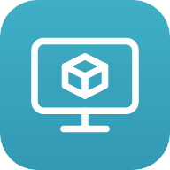
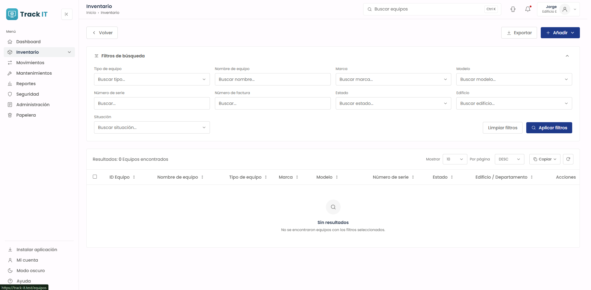
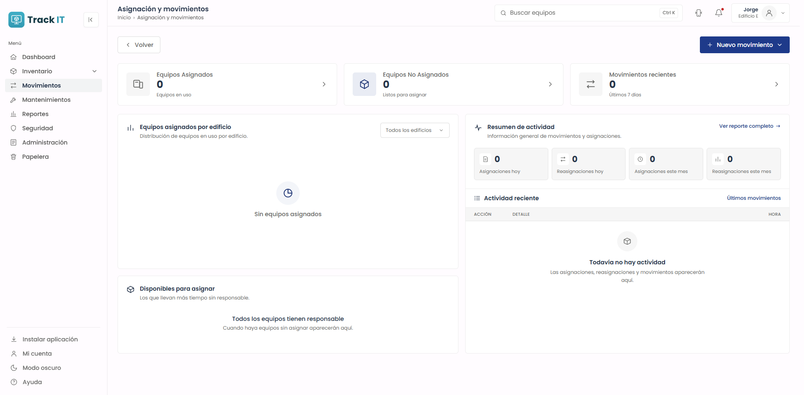
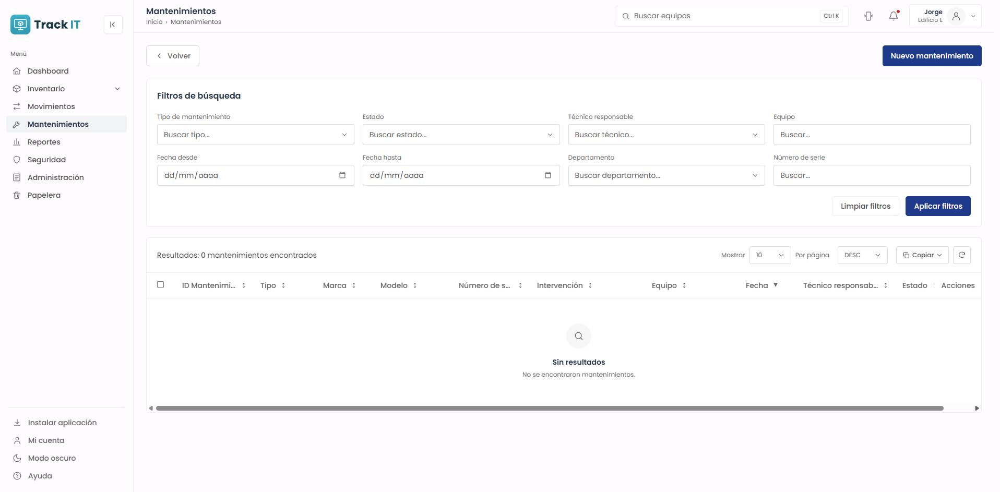
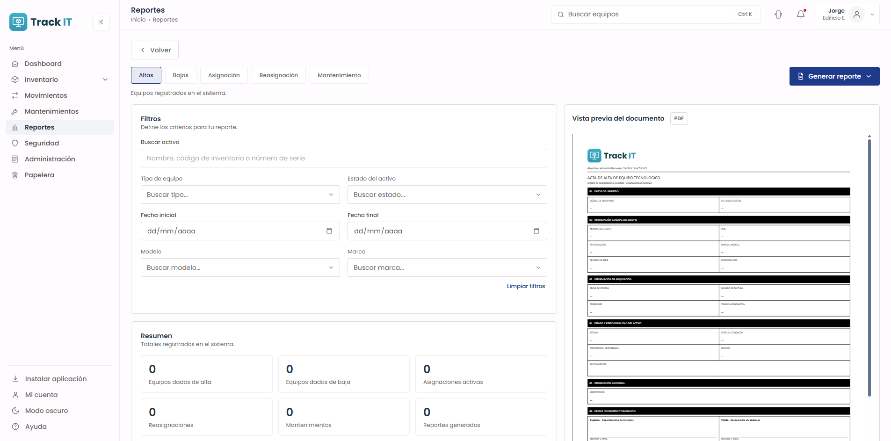
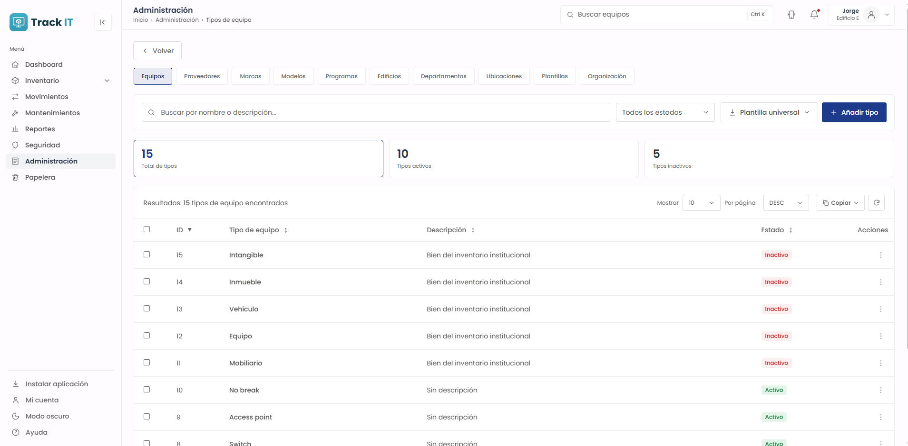
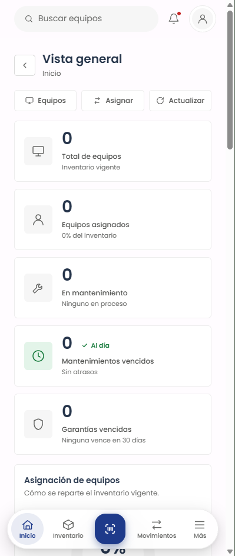

<p align="center">
  
</p>

<h1 align="center">Track IT</h1>

<p align="center">
  Sistema web para la gestión de activos tecnológicos: inventario, asignaciones, mantenimientos, bajas y reportes en un solo lugar.
</p>

---

## Contexto

Track IT nació como proyecto de Residencia Profesional (Ingeniería en Sistemas Computacionales, ITS de Felipe Carrillo Puerto) para el Departamento de Sistemas del Grand Palladium Riviera Maya. El control de los equipos se llevaba entre una plataforma existente, hojas de Excel y formatos en papel, lo que dificultaba saber dónde estaba cada equipo, quién lo tenía y en qué condiciones se encontraba.

El sistema concentra esa información y deja trazabilidad de cada movimiento durante todo el ciclo de vida del activo: alta, asignación, reasignación, devolución, mantenimiento y baja.

Funciona con **plantillas de organización**, que se eligen al configurar la instancia:

| Plantilla | Unidades | Ejemplo |
|---|---|---|
| Hotelería | Hoteles | Cadena hotelera con varios hoteles por sede |
| Educación | Edificios | Instituto o universidad con varios edificios por campus |

La plantilla cambia cómo se nombran las unidades en todo el sistema (menús, formularios, reportes y actas).

## Capturas

### Inventario
Filtros de búsqueda por tipo, marca, modelo, serie, factura, estado, edificio y situación.



### Asignación y movimientos
Equipos asignados y disponibles, distribución por edificio y resumen de actividad.



### Mantenimientos
Búsqueda por tipo, estado, técnico, fechas, departamento y número de serie.



### Reportes
Altas, bajas, asignaciones, reasignaciones y mantenimientos, con vista previa del documento en PDF.



### Administración
Tipos de equipo, proveedores, marcas, modelos, programas, edificios, departamentos, ubicaciones, plantillas y organización.



### Versión móvil
Vista general con el menú inferior flotante.

<p align="center"></p>

## Módulos

- **Inventario.** Alta de equipos con formularios distintos por tipo de equipo, importación desde Excel o CSV, búsqueda global (Ctrl K), filtros, exportación a PDF y Excel, y escáner de códigos de barras desde el teléfono.
- **Asignaciones y movimientos.** Asignación a personas o departamentos, asignación múltiple, reasignación, devolución con acta e historial completo por equipo.
- **Mantenimientos.** Preventivos y correctivos, con prioridad, técnico, refacciones, evidencias y avisos de mantenimientos programados.
- **Bajas.** Baja individual o múltiple con firmas y acta en PDF.
- **Reportes.** Altas, bajas, movimientos e inventario en PDF y Excel con el logotipo de la organización.
- **Administración.** Tipos de equipo y su constructor de formularios, marcas, modelos, programas, proveedores, sedes, edificios u hoteles, departamentos, ubicaciones e identidad visual (nombre, logotipo y color principal).
- **Seguridad.** Usuarios, roles y permisos, aprobación de registros, solicitudes de cambio de organización y bitácora de auditoría.
- **Cuenta.** Perfil, verificación en dos pasos (obligatoria para administradores), sesiones activas, notificaciones y preferencias.
- **Papelera.** Lo eliminado se conserva 30 días y se puede restaurar.
- **Aplicación instalable.** PWA con notificaciones push y menú móvil propio.

## Tecnologías

- PHP 8.4 y Laravel 13
- Livewire 4 y Alpine.js
- Tailwind CSS 4 y Vite
- PostgreSQL (Supabase)
- DomPDF y Laravel Excel
- Google2FA (verificación en dos pasos) y Web Push
- Docker (PHP 8.4 + Apache) para el despliegue en Render

## Instalación local

Requisitos: PHP 8.4 con Composer (por ejemplo, con [Laravel Herd](https://herd.laravel.com)), Node.js y una base PostgreSQL.

```bash
git clone https://github.com/RobertoNovelo12/track-it.git
cd track-it

composer install
npm install
npm run build

cp .env.example .env
php artisan key:generate   # solo en una instalación nueva
php artisan migrate
```

Con Herd, agrega la carpeta del proyecto en **Settings → General → Herd paths** y abre `http://track-it.test`.

### Variables de entorno

| Variable | Uso |
|---|---|
| `DB_HOST`, `DB_PORT`, `DB_DATABASE`, `DB_USERNAME`, `DB_PASSWORD` | Conexión a PostgreSQL. Con Supabase, usa el *session pooler* (puerto 5432). |
| `APP_KEY` | Cifra sesiones y secretos de la verificación en dos pasos. Debe ser la misma en todos los entornos que comparten base. |
| `VAPID_SUBJECT`, `VAPID_PUBLIC_KEY`, `VAPID_PRIVATE_KEY` | Notificaciones push. Se generan con `php artisan trackit:llaves-push`. |
| `SOPORTE_EQUIPO`, `SOPORTE_INTEGRANTES`, `SOPORTE_CORREO`, `SOPORTE_TELEFONO`, `SOPORTE_HORARIO` | Contacto de soporte que aparece en Ayuda. |
| `TRACKIT_PLANTILLA` | Opcional. Fija la plantilla (`hoteles` o `escuelas`); si no existe, se elige en el asistente. |

## Primer uso y restablecimiento

Desde **Administración → Plantillas → Restablecer** un administrador puede dejar la instancia como recién instalada. Pide la contraseña, dos confirmaciones y el código del autenticador.

- **Se elimina:** usuarios, sedes, edificios u hoteles, departamentos, ubicaciones, inventario con sus movimientos, mantenimientos y bajas, bitácora, notificaciones, logotipo y color principal.
- **Se conserva:** marcas, modelos, tipos de equipo y sus formularios, programas, proveedores, tipos de ubicación, catálogos, roles y permisos.

Después se muestra una sola vez un usuario temporal con contraseña aleatoria. Al entrar, un asistente por pasos pide la plantilla, el nombre, logotipo y color de la organización, la primera sede, el primer edificio u hotel, el primer departamento y la cuenta del administrador.

## Comandos útiles

| Comando | Qué hace |
|---|---|
| `php artisan trackit:exportar-entrega` | Genera `database/entrega/salida/track-it-entrega.sql` con la estructura completa y los catálogos, sin usuarios ni inventario. |
| `php artisan trackit:importar-entrega` | Restaura ese script en una base vacía. |
| `php artisan trackit:llaves-push` | Genera las llaves VAPID para las notificaciones push. |
| `php artisan trackit:vaciar-papelera` | Elimina lo que lleva más de 30 días en la papelera (programado a diario). |
| `php artisan schedule:work` | Ejecuta las tareas programadas en desarrollo. |

## Estructura

```
app/
  Http/Controllers/     Controladores (autenticación, instancia, reportes)
  Http/Middleware/      2FA obligatoria, contraseña temporal, configuración inicial
  Livewire/             Pantallas y componentes
  Services/             Lógica de negocio (organización, plantillas, papelera, reportes)
  Support/              Utilidades compartidas
database/
  migrations/           Esquema de la base
  entrega/              Exportación de la base de entrega
resources/views/
  layouts/              Layout principal, menú lateral y menú móvil
  livewire/             Vistas de los componentes
  reportes/             Plantillas de PDF
routes/                 Rutas web, de autenticación y tareas programadas
docker/                 Configuración de Apache, OPcache y arranque
```

## Despliegue

El repositorio incluye un `Dockerfile` (PHP 8.4 + Apache) que se usa en Render. Configura las variables de entorno del apartado anterior en el servicio y, en cada despliegue, ejecuta las migraciones con `php artisan migrate --force`.
